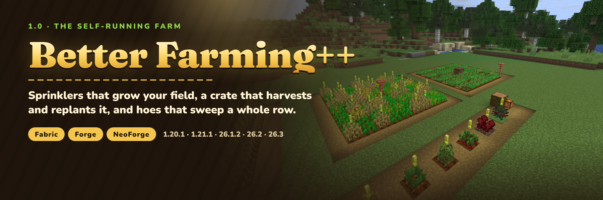

# Better Farming++



A vanilla-friendly farming mod for Minecraft: right-click harvest that replants with a seed from the drops, hoes that
sweep an area, a **Farming Crate** that harvests, replants and stores a whole field on its own, a **Sprinkler** that
waters farmland and speeds crops up, no more trampled farmland, and a marker above every ripe crop.

**1.0 "The Self-Running Farm"** rebuilds the mod: see the [1.0.0 notes](patchnotes/1.0.0.md), the
[design notes](docs/DESIGN-1.0.md) and the [QA record](docs/QA-1.0.0.md) (47 in-game checks on all ten builds).

## Which jar do I download?

Jar names are `better_farming_plus-{loader}-{minecraft}-{modVersion}.jar`. Match **both** the Minecraft version and
the loader.

| Minecraft | Java | Fabric jar (needs Fabric API) | NeoForge / Forge jar |
|-----------|------|-------------------------------|----------------------|
| 1.20.1 | 17+ | `…-fabric-1.20.1-1.0.0.jar` | `…-forge-1.20.1-1.0.0.jar` (Forge 47.4.0 or newer) |
| 1.21.1 | 21+ | `…-fabric-1.21.1-1.0.0.jar` | `…-neoforge-1.21.1-1.0.0.jar` (NeoForge 21.1.219 or newer) |
| 26.1.2 | 25+ | `…-fabric-26.1.2-1.0.0.jar` | `…-neoforge-26.1.2-1.0.0.jar` |
| 26.2 | 25+ | `…-fabric-26.2-1.0.0.jar` | `…-neoforge-26.2-1.0.0.jar` (NeoForge 26.2.0.93 or newer) |
| 26.3 | 25+ | `…-fabric-26.3-1.0.0.jar` | `…-neoforge-26.3-1.0.0.jar` |

Install it on the server and on clients. No other library is needed (0.5.0 needed JaUML; 1.0 does not).

## Features

### Right-click harvest

Right-click a ripe crop with an empty hand or a hoe: it is harvested and replanted with one seed taken from its own
drops. Works on wheat, carrots, potatoes, beetroots, nether wart and cocoa, on any modded crop that extends
`CropBlock`, and on any block added to `#better_farming_plus:harvestable`. Drops use the tool, so Fortune counts; a hoe
loses 1 durability per crop. Nothing around the crop is touched.

### Hoe sweep

Better hoes harvest more at once: iron and golden hoes **3×3**, diamond **5×5**, netherite **7×7** (only ripe crops;
young ones stay). Sneak to take a single crop. Sizes are set per item (or item tag) in the config.

### Farming Crate

Place it in a field: once a second it harvests every ripe crop in the **9×9** square around it (its own layer and one
above and below), replants them and stores the drops. A crop is only harvested when all of its drops fit, so a full
crate leaves the field standing instead of losing items. Hoppers and pipes take from it on every side; comparators
read it. Its screen shows how many crops it has harvested and whether it is working, full or waiting.

Recipe: planks, a redstone block, two comparators, a diamond hoe and a chest (unchanged from 0.5.0).

### Sprinkler

A copper sprinkler that needs water **up to 4 blocks straight below it** (hide one water block under the field) or
right beside it. Every 5 seconds it hydrates every farmland block in the **9×9** square around it and gives each
growing plant there a 15 % chance of an extra growth tick (the same random tick vanilla uses, so every crop grows by
its own rules). With vanilla's 3 random ticks per chunk section, that is about three times as many growth ticks.
Without water it stays dry and does nothing.

Recipe: four copper ingots around a bucket.

### No trampling

By default nobody, player or mob, tramples farmland any more (the fall itself still hurts). `"with_tool"` restores the
0.5.0 rule (only someone holding a harvest tool is stopped), `"vanilla"` turns protection off.

### Harvest indicators

A marker floats above ripe wheat, carrots, potatoes, beetroots, nether wart, sweet berries and attached melon and
pumpkin stems. It is a built-in resource pack, **Harvest Indicators**, switched on by default and listed in the
Resource Packs screen, where it can be turned off or moved below another pack.

## Configuration

`config/better_farming_plus.json` is written on first start, with comments. Changes apply after a restart. A 0.5.0
config (`config/betterfarming/global.json`) is migrated on the first start of 1.0.

| Key | Default | What it does |
|-----|---------|--------------|
| `harvest.enabled` | `true` | Right-click harvest at all |
| `harvest.empty_hand` | `true` | Harvest with an empty hand |
| `harvest.tools` | `["#minecraft:hoes"]` | Items (ids or `#tags`) that harvest |
| `harvest.sweep_radius` | iron/golden 1, diamond 2, netherite 3 | Sweep size per item or `#tag` (1 = 3×3); unlisted tools take one crop |
| `harvest.sneak_for_single` | `true` | Sneak to take only the clicked crop |
| `harvest.tool_damage` | `1` | Durability lost per crop |
| `trampling` | `"never"` | `"never"`, `"with_tool"` or `"vanilla"` |
| `farming_crate.radius`, `.interval_ticks` | `4`, `20` | Crate area (4 = 9×9) and how often it works |
| `sprinkler.radius`, `.interval_ticks` | `4`, `100` | Sprinkler area and how often it waters |
| `sprinkler.growth_chance` | `0.15` | Chance per plant per cycle of an extra growth tick |
| `sprinkler.needs_water`, `.hydrate_farmland` | `true`, `true` | Require water below or beside it; keep farmland wet |
| `harvest_indicators` | `true` | Add the Harvest Indicators resource pack |

Block tags (datapack data, `tags/block/` or `tags/blocks/` on 1.20.1):

| Tag | Default | Used for |
|-----|---------|----------|
| `better_farming_plus:harvestable` | nether wart, cocoa | Harvested besides every `CropBlock` |
| `better_farming_plus:not_harvestable` | torchflower crop | Never harvested |
| `better_farming_plus:sprinkler_boosted` | `#minecraft:crops`, sweet berry bush, cocoa, nether wart, sugar cane | Get extra growth ticks from sprinklers |

## Upgrading from 0.5.0

The Farming Crate keeps its block, item and block entity ids and its storage, so crates in existing worlds keep their
contents and start working with the new rules. The config is migrated. Remove JaUML if nothing else needs it.

## Building

Each Minecraft version is a separate MultiLoader Gradle workspace (`common/`, `fabric/` and `neoforge/`, or `forge/` on
1.20.1). Gradle needs the workspace's Java version: 17 for 1.20.1, 21 for 1.21.1, 25 for 26.x.

```bash
cd 26.3
./gradlew build          # jars in fabric/build/libs and neoforge/build/libs; runs the unit tests
```

`tools/build_release.sh` builds every workspace and copies the jars into `releases/` for the publish workflow.
Release notes for a version live in `patchnotes/<version>.md`.

## Tools

- [`tools/datagen.py`](tools/datagen.py): writes assets and data (models, loot tables, recipes, recipe advancements,
  tags, the indicator pack) into every workspace in that version's format. Edit the tables there, not the JSON.
- [`tools/gen_textures.py`](tools/gen_textures.py): draws the sprinkler textures and the crate screen.
- [`tools/qa/`](tools/qa): dev servers and a real game client under Xvfb. `farming_checks.py` checks every feature in
  game, `run_matrix.sh` runs it on every build, `marketing_shots.py` captures the listing screenshots.
- [`marketing/`](marketing): the CurseForge/Modrinth description, listing images and how to regenerate them.

## Links

- [Discord](https://discord.gg/SAmd9fhNhr)
- [Source and issues](https://github.com/MeherBenSalem/better_farming_plus)
- [Support us](https://nightbeam.dev/support)

## Contributing

See [CONTRIBUTING.md](CONTRIBUTING.md). Please follow the [Code of Conduct](CODE_OF_CONDUCT.md).

## Security

See [.github/SECURITY.md](.github/SECURITY.md).

## License

[Apache License 2.0](LICENSE). See [NOTICE](NOTICE).
