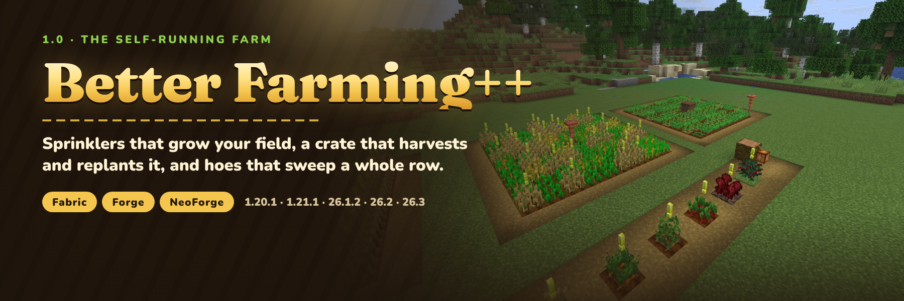

**[Docs](https://nightbeam.dev/docs/better-farming-plus) · [Discord](https://discord.gg/TJc3CxR4jK) · [Source and issues](https://github.com/MeherBenSalem/better_farming_plus)**

**A farm that runs itself, and farming by hand that finally feels good.** Right-click a ripe crop to harvest it and
replant it with a seed from its own drops. Swing a better hoe to take a whole patch at once. Drop a **Sprinkler** into
the field to keep it watered and growing, and a **Farming Crate** to harvest, replant and store everything around it.
Nobody tramples your farmland any more, and a marker shows which crops are ready.

Fabric and NeoForge (Forge on 1.20.1) · Minecraft 1.20.1, 1.21.1, 26.1.2, 26.2 and 26.3 · install on the server and
clients · no extra library needed

Version 1.0 rebuilds the mod. Here's what changed from 0.5:

- **The Sprinkler** (new): waters farmland from a water block hidden under the field and gives crops extra growth
  ticks, about three times as many as vanilla
- **The Farming Crate, rebuilt**: a centred 9×9 area, replants with seeds from the drops, stores every drop in full
  and never loses items when it is full (0.5 kept one item of each stack and deleted the rest)
- **Hoe sweep**: iron and golden hoes harvest 3×3, diamond 5×5, netherite 7×7; sneak for a single crop
- **Nether wart and cocoa** can be harvested; an empty hand and every hoe (modded too) work
- **Replanting costs a seed** from the drops, Fortune counts and hoes wear, so it plays fair
- **Nothing around a crop is destroyed** any more (0.5 broke whatever stood above it)
- **No trampling**, by players or mobs
- **Harvest indicators** as a built-in resource pack you can switch off in the Resource Packs screen
- A **commented config** (0.5 settings are migrated) and **no JaUML dependency**
- Now for **Minecraft 26.1.2, 26.2 and 26.3**; the 1.21.1 crate recipe and drop work again
- Your 0.5 crates keep their contents: every id is unchanged

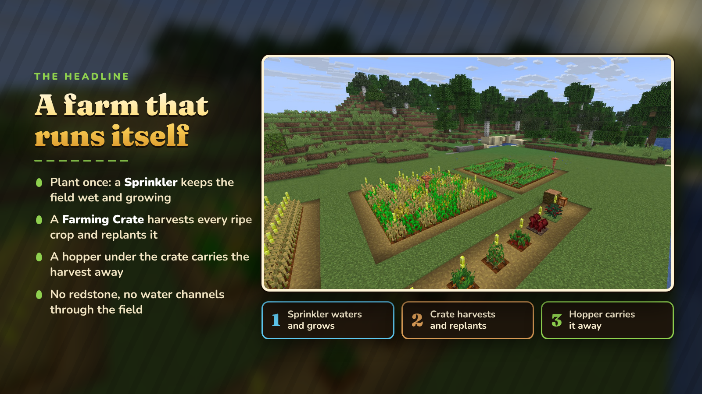

Plant a field, put a Sprinkler in it with one water block hidden below, and put a Farming Crate in it with a hopper
underneath. The Sprinkler keeps the farmland wet and the crops growing, the Crate harvests each crop the moment it is
ripe and replants it, and the hopper carries the harvest to a chest. No redstone, no water channels cutting through
the field.

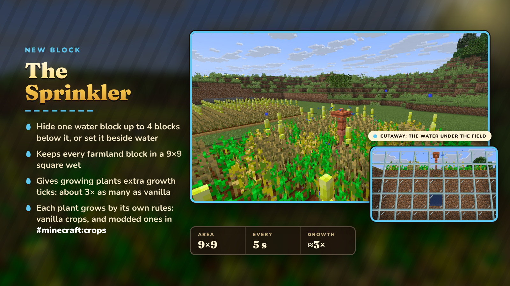

- Needs water **up to 4 blocks straight below it** (where vanilla water hydrates nothing) or right beside it.
- Every 5 seconds it hydrates every farmland block in the **9×9** square around it, from two blocks below it to one
  above, so it works sunk into the field or on a post.
- Each growing plant in that square gets a **15 % chance of an extra growth tick**, the same random tick vanilla uses,
  so every crop grows by its own rules (modded crops in `#minecraft:crops` too). That is about three times as many
  growth ticks as vanilla gives.
- Without water it stays dry and does nothing.
- Recipe: four copper ingots around a bucket.

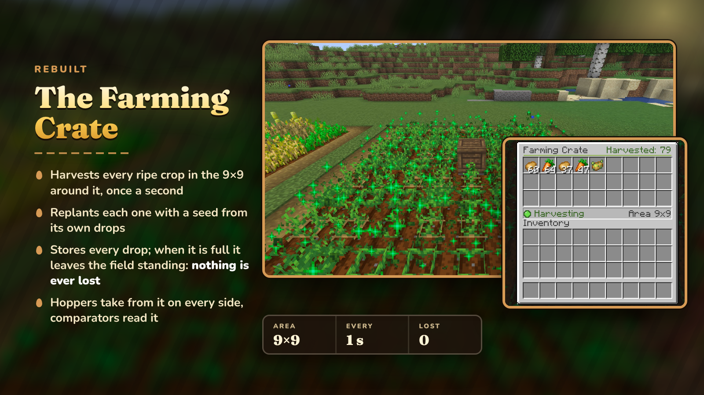

- Once a second it harvests every ripe crop in the **9×9** square around it, on its own layer and one above and below.
- Each crop is replanted with one seed taken from its own drops; the rest goes into the crate's 27 slots.
- A crop is harvested just when all of its drops fit, so a full crate **leaves the field standing instead of losing
  items**. It never picks up items that are lying around.
- Hoppers and pipes take from it on every side; nothing can be pushed in. Comparators read how full it is.
- Its screen shows how many crops it has harvested and whether it is harvesting, full or waiting for ripe crops.
- Recipe: planks, a redstone block, two comparators, a diamond hoe and a chest.

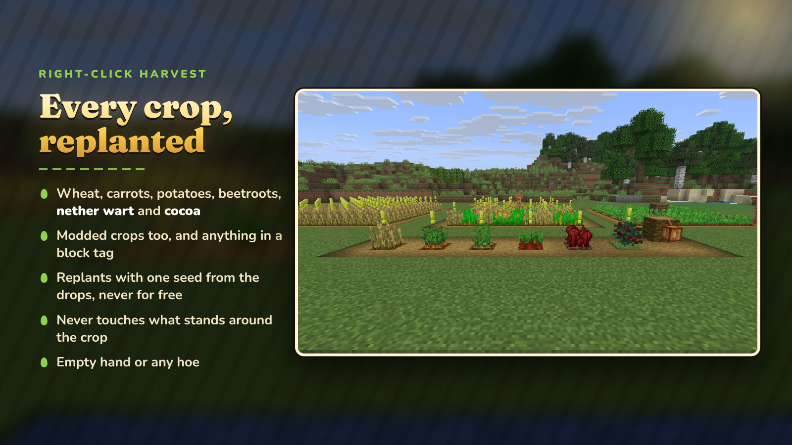

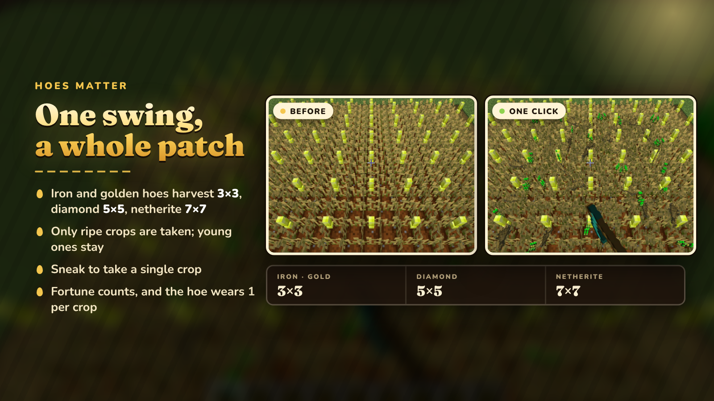

| Tool | Harvests |
|------|----------|
| Empty hand, wooden, stone or any other hoe | the crop you click |
| Iron or golden hoe | 3×3 |
| Diamond hoe | 5×5 |
| Netherite hoe | 7×7 |

- Works on wheat, carrots, potatoes, beetroots, nether wart and cocoa, on modded crops that extend the vanilla crop
  block, and on anything in `#better_farming_plus:harvestable`.
- Ripe crops are the ones harvested; young ones in a sweep stay. Sneak to take a single crop.
- Drops are rolled with your tool, so Fortune counts. The hoe loses 1 durability per crop.
- One seed from the drops replants the crop (cocoa keeps its side of the log).

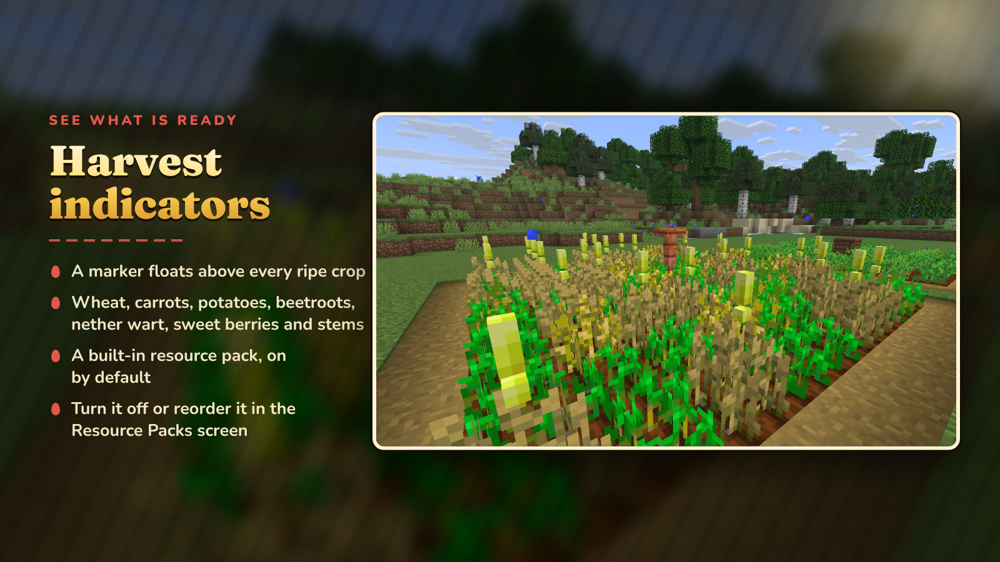

A marker floats above ripe wheat, carrots, potatoes, beetroots, nether wart, sweet berries and attached melon and
pumpkin stems. It comes as a built-in resource pack, **Harvest Indicators**, switched on by default: turn it off or
put another pack above it in the Resource Packs screen.

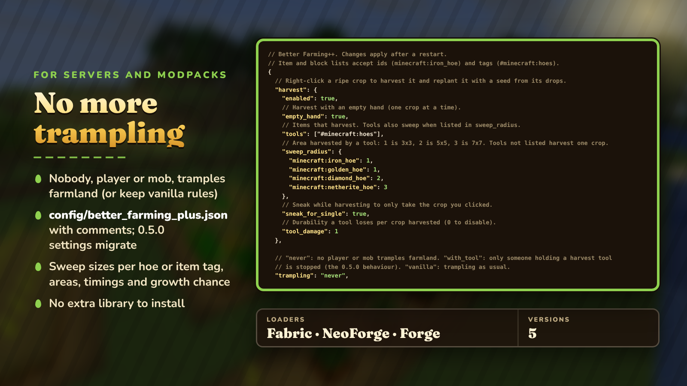

- **No trampling**: by default no player or mob tramples farmland (the fall still hurts). Set `"trampling"` to
  `"with_tool"` for the 0.5 rule or `"vanilla"` to turn protection off.
- **`config/better_farming_plus.json`**, written with comments at startup: harvest tools, sweep sizes per item or
  item tag, tool wear, the crate's and the sprinkler's area and timing, the growth chance, whether sprinklers need
  water, and the indicator pack.
- **Block tags** for modpacks: `#better_farming_plus:harvestable`, `#better_farming_plus:not_harvestable` and
  `#better_farming_plus:sprinkler_boosted`.
- A 0.5 config (`config/betterfarming/global.json`) is migrated automatically. JaUML is no longer needed.

Pick the file that matches **both** your Minecraft version and your loader:

| Minecraft | Fabric (needs Fabric API) | NeoForge / Forge |
|-----------|---------------------------|------------------|
| 1.20.1 | `better_farming_plus-fabric-1.20.1-1.0.0.jar` | `better_farming_plus-forge-1.20.1-1.0.0.jar` (Forge 47.4.0+) |
| 1.21.1 | `better_farming_plus-fabric-1.21.1-1.0.0.jar` | `better_farming_plus-neoforge-1.21.1-1.0.0.jar` (NeoForge 21.1.219+) |
| 26.1.2 | `better_farming_plus-fabric-26.1.2-1.0.0.jar` | `better_farming_plus-neoforge-26.1.2-1.0.0.jar` |
| 26.2 | `better_farming_plus-fabric-26.2-1.0.0.jar` | `better_farming_plus-neoforge-26.2-1.0.0.jar` (NeoForge 26.2.0.93+) |
| 26.3 | `better_farming_plus-fabric-26.3-1.0.0.jar` | `better_farming_plus-neoforge-26.3-1.0.0.jar` |

Install it on the server and on every client.

**Do I need to start a new world?** No. Farming Crates from 0.5 keep their contents and start working with the new
rules, and your 0.5 config is carried over.

**Does it work with modded crops?** Crops built on the vanilla crop block are harvested and replanted automatically,
and sprinklers speed up anything in `#minecraft:crops`. Other plants can be added to the mod's block tags.

**Why did a crop not come back?** A crop is replanted with a seed from its own drops. If a modded crop drops no seed,
it is harvested without replanting rather than replanted for free.

**Where does the sprinkler get its water?** From a water block up to 4 blocks straight below it, or right beside it.
A water block two blocks under the farmland hydrates nothing on its own, so the sprinkler lets you hide it.

**Can I turn the markers off?** Yes: switch off the Harvest Indicators pack in the Resource Packs screen, or set
`harvest_indicators` to `false`.

**Does it need to be on the client?** Yes, install it on both: the client needs the blocks, the crate screen and the
indicators.

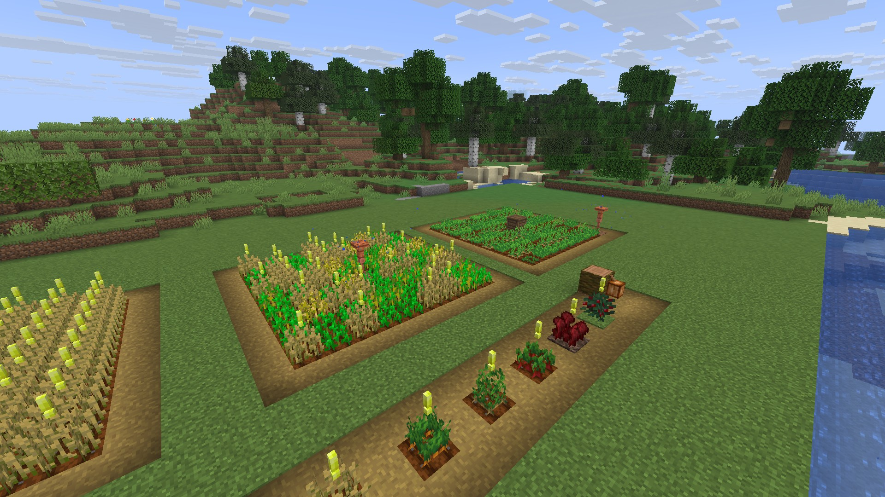

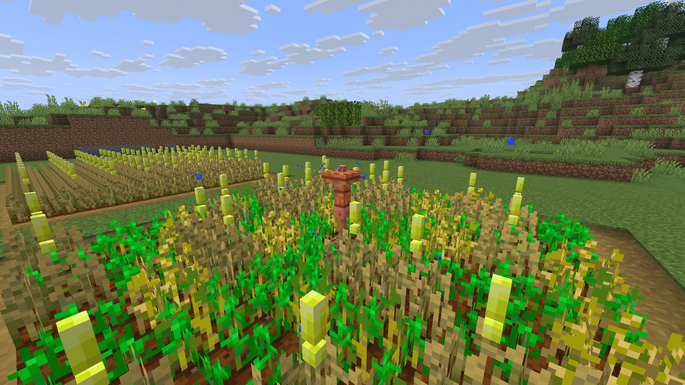

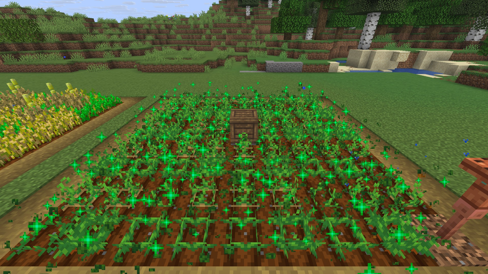

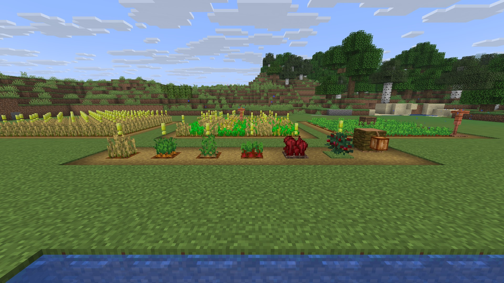

*Screenshots are single unedited frames from Minecraft 26.3 (Fabric). The fields were laid out with commands; for the
sprinkler cutaway the ground in front of the sprinkler was dug out and a row of glass put in front of the water block
hidden under the field.*

---

> **Featured in [Remnants: Ashen Legacy](https://www.curseforge.com/minecraft/modpacks/remnants-ashen-legacy)**, NightBeam's story-driven soulslike RPG modpack.

---

### More from NightBeam Studio

- **[Remnants: Ashen Legacy](https://www.curseforge.com/minecraft/modpacks/remnants-ashen-legacy)**: the story-driven soulslike RPG modpack built on NightBeam's mods
- **[Premium server plugins](https://nightbeam.dev/store)**: anti-cheat, ranked PvP, SMP setups and more on BuiltByBit
- **[NightBeam Pro](https://nightbeam.dev/memberships)**: the model library and NightBeam Forge credits, from $5 a month
- **[Discord](https://discord.gg/TJc3CxR4jK)**: support, bug reports, suggestions and early looks
- **[Support NightBeam](https://nightbeam.dev/support)**: help keep every mod free

**Follow:** [YouTube](https://www.youtube.com/@nightbeamstudio) · [Instagram](https://www.instagram.com/nightbeamstudio/) · [X](https://x.com/NightBeamLLC) · [Facebook](https://www.facebook.com/profile.php?id=61574823331471)
